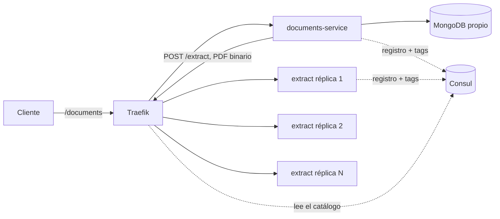

# documents-service

Microservicio de **persistencia de documentos PDF ya procesados**. Guarda, consulta y borra documentos, evita duplicados por checksum SHA-256 y orquesta la extracción de texto delegándola en `extract-service`.

Es el segundo microservicio del TP de *Test de Carga, Estrés y Optimización de Microservicio* (UTN FRSR). El primero — `extract-service`, el que se mide con k6 y Vegeta — vive en [`extract-service`](https://github.com/juandelosrios124/extract-service).

## Qué hace y qué no

**Hace:** guardar, consultar y borrar documentos; deduplicar por checksum; orquestar la extracción con resiliencia (circuit breaker, bulkhead, timeout y un reintento acotado).

**No hace:** extraer texto (eso es de `extract-service`), autenticar usuarios, resumir ni traducir. Tampoco agrega endpoints ni dependencias a `extract-service`: la ruta que se mide en el TP queda intacta.

## Por qué existe

`extract-service` se satura bajo carga — en las mediciones del repo hermano, 40,8 % de éxito y P95 de 30 s con Vegeta a 50 req/s. Alguien tiene que reaccionar bien a eso: fallar rápido, no reintentar a ciegas y seguir sirviendo lecturas mientras el extractor está caído. Ese es el trabajo de este servicio, y es lo que convierte los patrones del apunte en código real.

## Arquitectura



Traefik ([`pdf_extractext-infra`](https://github.com/juandelosrios124/pdf_extractext-infra)) es el gateway del sistema: arma sus rutas leyendo los **tags** que cada servicio declara al registrarse en Consul. `documents` se publica en `/documents` y llama a extract **a través de Traefik** (`EXTRACT_URL=http://traefik`): ya no elige réplicas por su cuenta. Ver [Llamar a extract a través de Traefik](#llamar-a-extract-a-través-de-traefik).

Capas, de afuera hacia adentro:

```
app/api/            HTTP: routers, DTOs y providers de dependencias
app/services/       casos de uso + patrones de resiliencia
app/repositories/   adaptador de MongoDB
app/ports.py        Protocol: lo único que la capa de servicios conoce
```

La capa de servicios depende de `Protocol`, nunca de Motor ni de httpx. Eso es lo que permite que toda la suite —incluido el test de resiliencia del criterio de aceptación— corra sin MongoDB, sin `extract-service` y sin red.

## Contrato

| Método | Ruta | Descripción | Respuestas |
|---|---|---|---|
| `POST` | `/documents` | Recibe un PDF (`multipart/form-data`, campo `file`), calcula el SHA-256 y, si no existe, llama a `extract-service` y guarda el resultado | `201` nuevo · `200` duplicado (`"duplicate": true`) · `400` vacío, no PDF, sin campo `file` o sin `multipart/form-data` · `413` demasiado grande · `422` el texto extraído supera `MAX_CONTENT_BYTES` · `502` respuesta inválida de extract · `503` + `Retry-After` si extract no está disponible (incluye el `502`, `503` y `404` del gateway), si no hay cupo de extracción o si no hay cupo para recibir el upload · `504` timeout, propio o del gateway |
| `GET` | `/documents/{id}` | Documento completo, con `content` | `200` · `404` |
| `GET` | `/documents?limit=&offset=` | Listado **sin** `content` | `200` |
| `DELETE` | `/documents/{id}` | Borra | `204` · `404` |
| `GET` | `/health` | Liveness, no toca nada | `200 {"status":"ok"}` |
| `GET` | `/health/ready` | Readiness: depende de **su propia** base; informa el estado del circuito de extract | `200` · `503` |

Documentación interactiva en `/docs`.

Hacia `extract-service` el PDF viaja como **cuerpo binario** (`Content-Type: application/pdf`), que es el camino que usa la cátedra, con el `X-Request-ID` propagado.

### Ejemplo

```bash
# Por Traefik (puerto 8080 de infra) o directo al puerto de documents (8002)
curl -F "file=@informe.pdf" http://127.0.0.1:8080/documents
curl -F "file=@informe.pdf" http://localhost:8002/documents
# 201 {"id":"...","filename":"informe.pdf","checksum":"...","content":"...","page_count":12,"duplicate":false,...}

curl -F "file=@informe.pdf" http://localhost:8002/documents
# 200 {... "duplicate":true}   <- sin volver a llamar a extract-service
```

## Configuración

Todo por variables de entorno, sin valores en el código y sin secretos en el repo (12-Factor III). Ver `.env.example`.

| Variable | Default | Para qué |
|---|---|---|
| `HOST` / `PORT` | `0.0.0.0` / `8002` | Port binding (12-Factor VII) |
| `LOG_LEVEL` / `LOG_FORMAT` | `INFO` / `text` | Logs a stdout; `json` para agregadores |
| `MONGO_URI` | `mongodb://localhost:27017` | Base propia |
| `MONGO_DB_NAME` | `documents_db` | **Rechaza `pdf_extract_db`**: es del monolito |
| `MONGO_TIMEOUT_MS` | `3000` | Para que `/health/ready` falle rápido |
| `SHARED_NETWORK` | `mired` | Red Docker externa compartida con Consul y `extract-service`. Misma variable en los tres repos |
| `EXTRACT_URL` | `http://localhost:8001` | Base de `extract-service`, **sin `/extract`** (el cliente lo agrega). El compose usa el gateway, `http://traefik`; rollback: `http://extract:8001` |
| `EXTRACT_TIMEOUT` | `27.0` | Presupuesto de timeouts: cliente 30 s > documents 27 s > Traefik 25 s. Corta después que Traefik, así el `504` lo da el gateway |
| `EXTRACT_CONNECT_TIMEOUT` | `2.0` | Con extract caído se falla en 2 s, no en 25 |
| `MAX_UPLOAD_SIZE` | `52428800` | No debe superar el de `extract-service` |
| `MAX_CONTENT_BYTES` | `15728640` | Tope del texto extraído, en bytes UTF-8. Se guarda inline y un documento BSON no pasa de 16 MiB: 15 MiB deja 1 MiB de margen. Debe ser > 0 y < 16 MiB o el servicio no arranca. Si se supera → `422` sin tocar Mongo |
| `MAX_CONCURRENT_UPLOADS` | `4` | Uploads retenidos en memoria a la vez. Cada uno puede ocupar hasta dos copias del PDF: con 512 MB y 50 MB por archivo, 4 deja margen |
| `UPLOAD_SLOT_TIMEOUT` | `2.0` | Sin cupo de upload en ese tiempo → `503`, sin haber leído el body |
| `MAX_CONCURRENT_EXTRACTIONS` | `4` | Bulkhead |
| `BULKHEAD_ACQUIRE_TIMEOUT` | `2.0` | Sin cupo en ese tiempo → `503` |
| `BREAKER_FAILURE_THRESHOLD` | `5` | Fallas para abrir el circuito |
| `BREAKER_OPEN_SECONDS` | `15.0` | Cuánto queda abierto antes de la sonda |
| `BREAKER_WINDOW_SECONDS` | `30.0` | Ventana deslizante: las fallas viejas no cuentan |
| `CONSUL_ENABLED` | `false` (compose: `true`) | **Solo** el registro en Consul, con los tags que publican a documents en Traefik. No cambia a dónde se llama a extract. Apagado: el servicio funciona igual sin Consul |
| `CONSUL_HTTP_ADDR` | `http://consul:8500` | Agente de Consul, visto desde `mired` |
| `CONSUL_HTTP_TOKEN` | *(vacío)* | Token de ACL. Solo por entorno, nunca en el repo |
| `CONSUL_TIMEOUT` | `2.0` | Tope para hablarle al agente: el arranque no espera a un Consul que no responde |
| `CONSUL_CACHE_TTL` | `5.0` | Sin uso desde que descubre Traefik; se elimina con `ConsulEndpoints` en la próxima issue |

## Cómo levantarlo

### Con Docker

```bash
docker network create mired   # una sola vez por maquina; si ya existe, ignorar el error
docker compose up --build
curl http://localhost:8002/health
```

`mired` es la red externa que comparten los tres repos del proyecto: ahí viven Consul y las réplicas de `extract-service`. Al ser externa, `docker compose up` falla si no se creó antes, y `docker compose down` no la borra. Mongo queda **solo** en la red privada de este stack: es la base de este servicio y nadie de `mired` tiene por qué alcanzarla.

Levanta `documents` y su MongoDB, ambos con límites explícitos de CPU y RAM. Ajustables por entorno: `DOCUMENTS_CPUS`, `DOCUMENTS_MEMORY`, `MONGO_CPUS`, `MONGO_MEMORY`.

### Local

```bash
uv sync
cp .env.example .env
docker compose up -d mongo          # o un MongoDB propio
uv run --env-file .env python -m app
```

### Cómo apuntar a `extract-service`

Este compose **no** levanta `extract-service`: es un repositorio aparte y acoplarlos rompería la autonomía del servicio. Hay cuatro formas de conectarlos:

1. **Por Traefik** (default). `EXTRACT_URL=http://traefik`, que es lo que trae el compose: Traefik escucha en el puerto 80 de `mired` y rutea `/extract` a las réplicas que extract publicó en Consul.
   ```bash
   docker network create mired                      # una sola vez
   cd ../pdf_extractext-infra && docker compose up -d --wait
   cd ../extract-service && CONSUL_HTTP_TOKEN=<uuid> docker compose up -d --build --wait
   cd ../documents-service && CONSUL_HTTP_TOKEN=<uuid> docker compose up -d --build
   ```
2. **Directo a extract en `mired`, sin Traefik** (rollback). `EXTRACT_URL=http://extract:8001`: el DNS de Docker devuelve una IP por réplica.
   ```bash
   EXTRACT_URL=http://extract:8001 docker compose up -d
   ```
3. **extract corriendo en el host.** `EXTRACT_URL=http://host.docker.internal:8001`. El `extra_hosts: host-gateway` hace que ese nombre resuelva también en Linux.
   ```bash
   cd ../extract-service && uv run --env-file .env python -m extractor
   ```
4. **extract en otra máquina.** `EXTRACT_URL=http://host-remoto:8001`.

### Service discovery con Consul

Con `CONSUL_ENABLED=true`, el servicio se registra en [Consul](https://github.com/juandelosrios124/pdf_extractext-infra) al arrancar y se desregistra al apagarse. En `Settings` viene **apagado** y el compose lo **enciende** (como extract), porque registrarse es lo que lo publica en Traefik. Sin Consul funciona igual, y si el registro falla arranca de todas formas y solo queda un `WARNING` en el log. `CONSUL_ENABLED` controla **solo** el registro: a extract se llama siempre por `EXTRACT_URL`.

```bash
CONSUL_ENABLED=true CONSUL_HTTP_TOKEN=<el mismo UUID que el .env de infra> docker compose up -d --build
```

Lo que registra:

| Campo | Valor | Por qué |
|---|---|---|
| `ID` | hostname del contenedor | Uno por instancia |
| `Name` | `documents` | |
| `Address` | su IP en `mired` | Está en dos redes; se publica la de la red compartida, que es la que ve Consul |
| `Port` | `8002` | |
| `Check` | `HTTP` a `http://<IP>:8002/health`, `Interval 10s`, `Timeout 2s` | **Liveness, no readiness.** `/health/ready` depende de Mongo: un blip de la base nos sacaría del catálogo cuando todavía servimos lecturas y rechazamos escrituras correctamente |
| `DeregisterCriticalServiceAfter` | `1m` | Un `docker kill` no da tiempo a desregistrarse |
| `Tags` | ver abajo | Lo que lee Traefik para publicar el servicio |

Los tags salen de `traefik_tags()` (`app/services/consul.py`), igual que en extract:

| Tag | Para qué |
|---|---|
| `traefik.enable=true` | Traefik corre con `exposedByDefault=false`: sin este tag no publica nada |
| ``traefik.http.routers.documents.rule=PathPrefix(`/documents`)`` | La ruta pública del servicio |
| `traefik.http.routers.documents.entrypoints=web` | Solo el entrypoint de tráfico; el otro es el del dashboard |

A diferencia de extract, documents **no** declara middlewares (circuit breaker, retry, inFlightReq) en Traefik.

Comprobar, con Consul levantado:

```bash
docker exec pdf_extractext-infra-consul-1 consul catalog services     # debe listar "documents"
curl -s "http://127.0.0.1:8500/v1/health/service/documents?passing"
curl -s http://127.0.0.1:8081/api/http/routers   # debe listar documents@consulcatalog y extract@consulcatalog
```

El token viaja en el header `X-Consul-Token`, sale del entorno y no se escribe en los logs.

### Llamar a extract a través de Traefik

Hasta la issue #27, con `CONSUL_ENABLED=true` documents le preguntaba a Consul por las réplicas `passing` de extract y elegía una por pedido (`ConsulEndpoints`). Ahora **eso lo hace Traefik**: descubre las réplicas en el catálogo de Consul, balancea entre ellas y las saca de la rotación cuando su check deja de estar `passing`. documents siempre llama a una URL fija, `EXTRACT_URL`, con o sin Consul.

| | Antes (#24) | Ahora (#27) |
|---|---|---|
| Destino | una réplica `passing`, elegida por documents | `EXTRACT_URL` = `http://traefik` |
| Quién descubre réplicas | documents (`GET /v1/health/service/extract`) | Traefik (provider Consul Catalog) |
| `CONSUL_ENABLED` | registro + discovery | **solo** el registro |

**Ojo con la URL:** el cliente agrega `/extract` a la base, así que es `EXTRACT_URL=http://traefik`, **no** `http://traefik/extract`.

**Respuestas propias del gateway.** Llamando a extract directo no podían ocurrir; a través de Traefik son la forma en que avisa que no llegó a una réplica. `ExtractorClient._parse` las traduce:

| Traefik responde | Por qué | documents lo trata como | Al cliente |
|---|---|---|---|
| `504` | cortó por `responseHeaderTimeout` (25 s) | `ExtractTimeoutError` (no se reintenta) | `504` |
| `502` | no pudo hablar con la réplica | `ExtractUnavailableError` | `503` |
| `404` | no tiene ruta: extract no está registrado en Consul (se loguea un `WARNING`) | `ExtractUnavailableError` | `503` |
| `503` | su circuit breaker está abierto, o "no available server" | `ExtractUnavailableError`, como el `503` de extract | `503` |

**Dos circuit breakers, por ahora.** Hasta la próxima issue ("Eliminar circuit breaker, bulkhead, retry y discovery propios") conviven el circuit breaker de Traefik (middleware `extract-cb`, declarado por extract en sus tags) y el propio de documents. Las respuestas del gateway de arriba cuentan como fallas del breaker propio, igual que antes contaba un extract caído. El efecto es que con extract caído responde primero el que abra antes; el resultado para el cliente es el mismo `503`. `ConsulEndpoints` sigue en el código, sin usar, y se va en esa misma issue.

**Rollback.** Si Traefik da problemas, se vuelve a llamar a extract directo, sin tocar código:

```bash
EXTRACT_URL=http://extract:8001 docker compose up -d
```

El log de arranque (`Servicio iniciado`) dice a dónde se llama (`extract_destino`) y si el registro en Consul está activo (`consul_registro`) y salió bien (`consul_registrado`).

Comprobar, con todo levantado:

```bash
# Routers que armó Traefik: documents y extract
curl -s http://127.0.0.1:8081/api/http/routers | python -m json.tool | grep '"name"'

# Un upload que entra por Traefik, pasa por documents y vuelve a entrar por Traefik hacia extract.
# El mismo X-Request-ID aparece en el access log de Traefik (los dos pedidos) y en los logs de ambos servicios.
curl -H "X-Request-ID: prueba-traefik-1" -F "file=@informe.pdf" http://127.0.0.1:8080/documents
docker logs pdf_extractext-infra-traefik-1 2>&1 | grep prueba-traefik-1
```

## Resiliencia

El orden de las capas, de afuera hacia adentro:

```
breaker.call(  ->  retry (1 vez, solo ante 503)  ->  bulkhead.slot()  ->  timeout  ->  httpx
```

- **El breaker va afuera de todo.** Con el circuito abierto el rechazo es inmediato y *no consume cupo del bulkhead*. Es literalmente el criterio de aceptación: `503` en milisegundos con extract caído.
- **El retry va adentro del breaker**, así los dos intentos cuentan como un solo resultado para el circuito: un `503` reintentado y fallado es una falla, no dos.
- **El bulkhead va adentro del retry**, así el reintento vuelve a pedir cupo y una ráfaga de reintentos no se saltea el límite de concurrencia.

Dos decisiones que parecen detalles y no lo son:

- **`CircuitOpenError` y `BulkheadFullError` no son `ExtractUnavailableError`** y el breaker no las cuenta. Si contara su propio rechazo se quedaría abierto para siempre; si contara el bulkhead lleno, le echaría a `extract-service` la culpa de nuestro propio *load shedding*.
- **Un timeout nunca se reintenta.** Reenviar un PDF de varios megabytes a un servicio ya saturado duplicaría la carga sobre el cuello de botella que el TP pide no empeorar. Solo se reintenta un `503`, una vez, respetando `Retry-After` (en sus dos formas legales: segundos y HTTP-date). Si el `Retry-After` es largo, no esperamos: se lo pasamos al cliente para que decida.

**Límite de tamaño y control de admisión del upload.** `POST /documents` no declara un `UploadFile`: con `File(...)`, FastAPI parsea todo el multipart (y vuelca a disco lo que pase de 1 MB) *antes* de que corra el endpoint, así que ningún chequeo de tamaño llegaba a tiempo. El endpoint lee el body él mismo, en este orden:

1. `Content-Length` declarado mayor que `MAX_UPLOAD_SIZE` + 64 KiB de margen para el framing → `413`, sin leer el body y sin tomar cupo.
2. Sin `multipart/form-data` con boundary → `400`.
3. Toma un cupo de admisión (`MAX_CONCURRENT_UPLOADS`). Si no se libera en `UPLOAD_SLOT_TIMEOUT` → `503` + `Retry-After`, sin leer el body.
4. Lee `request.stream()` y corta con `413` apenas se pasa del límite + margen. El `Content-Length` puede mentir o faltar (chunked); lo que acota la memoria es el total leído.
5. Parsea el multipart en memoria (`app/api/multipart.py`, sobre el parser de bajo nivel de `python-multipart`) y exige que el archivo no supere `MAX_UPLOAD_SIZE` exacto.

El cupo cubre lectura, extracción y persistencia, porque el PDF queda en memoria hasta el final, y se libera siempre: tras un error, tras un `413` o si el cliente corta. Convive con el bulkhead: el cupo de upload acota la memoria del proceso; el bulkhead, las llamadas a `extract-service`. El tamaño es un límite de transporte y vive solo en la capa HTTP; `DocumentService` valida solo reglas de dominio (vacío, extensión `.pdf`, magic `%PDF`).

**Idempotencia.** El checksum se consulta *antes* de tocar el breaker y el bulkhead, así un PDF repetido no llama a extract, no consume cupo y no puede abrir el circuito. La garantía real es el índice único `ux_documents_checksum`: si dos subidas idénticas corren la carrera, el índice gana y la segunda recibe `200` con `duplicate: true`.

## Patrones del apunte y dónde están en el código

| Patrón | Dónde | Test |
|---|---|---|
| Circuit Breaker | `app/services/circuit_breaker.py` | `tests/test_circuit_breaker.py` |
| Bulkhead | `app/services/bulkhead.py` | `tests/test_bulkhead.py` |
| Timeout + reintento acotado | `app/services/extractor_client.py` | `tests/test_extractor_client.py` |
| Health Check API | `app/api/health.py` | `tests/test_api_health.py` |
| Database per service | `docker-compose.yml` (Mongo propio, sin puerto publicado) + validador en `app/config.py` | `tests/test_config.py` |
| Externalized configuration | `app/config.py` | `tests/test_config.py` |
| Idempotencia por checksum | `app/services/document_service.py` + índice único en `app/db/mongo.py` | `tests/test_document_service.py` |
| Puertos y adaptadores | `app/ports.py`, `app/repositories/`, `app/services/extractor_client.py` | toda la suite corre con dobles |
| Correlación de requests | `app/middleware.py` | `tests/test_correlation.py` |
| API Gateway + service discovery (Traefik lee los tags de Consul) | `traefik_tags()` en `app/services/consul.py`, `EXTRACT_URL` en `docker-compose.yml` | `tests/test_consul.py` |
| Logs a stdout | `app/logging_config.py` | `tests/test_logging.py` |

## Tests

```bash
uv run pytest                 # 272 tests, sin MongoDB ni extract-service, ~2 s
```

Nada duerme: el circuit breaker recibe un reloj inyectado (`app/clock.py`), así que los quince casos de la máquina de estados corren en milisegundos. Esa es la razón por la que el breaker está escrito a mano en vez de importado — las librerías disponibles son síncronas o no dejan inyectar el tiempo.

El test de resiliencia del criterio de aceptación (`tests/test_resilience.py`) usa el `ExtractorClient` real con solo el socket mockeado, así que entra en la corrida de siempre en vez de quedar salteado.

Los tests que necesitan un MongoDB real están aparte y excluidos por default:

```bash
docker compose up -d mongo
MONGO_URI=mongodb://localhost:27017 uv run pytest tests/integration -m integration --override-ini addopts=
```

Cubren lo que un doble no puede probar honestamente: que el índice único rechaza de verdad un checksum repetido, que los timestamps vuelven con zona horaria y que un `content` de 15 MiB entra en Mongo mientras que uno de 17 MiB termina en `ContentTooLargeError` y no en un `500`.

## Decisiones de diseño

- **Estructura.** Sobre el esqueleto sugerido en la especificación se agregaron `models.py`, `ports.py`, `exceptions.py`, `clock.py` y `db/`. Cada uno es un concern separado con test propio, y espejan el layering de `extract-service`.
- **Sin motor de migraciones.** `create_index` es idempotente; una llamada en el lifespan alcanza (KISS). Copiar el motor de migraciones del repo hermano traería un lock distribuido que acá no hace falta — y dos servicios migrando la misma base competirían por él.
- **`tz_aware=True` en el cliente de Mongo.** Sin eso, un documento recién creado serializa con `+00:00` y el mismo documento releído serializa naive: el mismo recurso con dos representaciones según si el proceso se reinició.
- **El listado siempre ordena por `_id` descendente.** `find().skip().limit()` sin `sort` no tiene orden definido en MongoDB, y `offset=10` podría devolver filas ya vistas en `offset=0`.
- **El middleware de correlación es ASGI puro.** `BaseHTTPMiddleware` corre la app en otra task, así que un `ContextVar` seteado antes de `call_next` no se ve de forma confiable desde el endpoint: el request id saldría como `-` en todos los logs de la capa de servicios.
- **El `HEALTHCHECK` apunta a `/health`, no a `/health/ready`.** Atar el healthcheck del contenedor a la readiness significa que un parpadeo de Mongo reinicia un proceso que estaba sano.
- **Se guarda `page_count` y `size_bytes`** aunque el contrato mínimo no los pida: el primero viene gratis de la extracción y tirarlo después de pagarla es peor que cargarlo, y los dos son lo que hace útil al listado sin `content`.

## Límites conocidos

- **Un solo proceso.** El estado del breaker y del bulkhead vive en memoria: con N workers habría N circuitos independientes y una concurrencia efectiva de N × `MAX_CONCURRENT_EXTRACTIONS`. Escalar horizontalmente requeriría mover el estado del breaker a algo compartido (Redis), que está fuera del alcance del TP.
- **El texto extraído tiene tope (`MAX_CONTENT_BYTES`).** Se guarda inline en el documento, y un PDF de 50 MB puede dar más texto del que entra en los 16 MiB de BSON. El chequeo es después de la extracción, así que un documento rechazado por tamaño ya pagó la llamada a `extract-service` y **no queda guardado**: si se vuelve a subir, se vuelve a extraer. Guardar textos más grandes requeriría GridFS, que queda fuera del alcance.
- **La paginación con `skip` es O(offset).** Para colecciones grandes correspondería un cursor, pero el TP no lo necesita (YAGNI).
- **Este stack suma memoria.** No conviene levantarlo mientras se corren las mediciones de carga sobre `extract-service`.

## Pruebas de carga

Están en [`extract-service/tests/stress/`](https://github.com/juandelosrios124/extract-service/tree/main/tests/stress) y apuntan **solo** a `extract-service`, que es el servicio que mide la consigna. Este repositorio no agrega scripts de k6 ni de Vegeta a propósito: medir este servicio con el benchmark de la cátedra daría números no comparables.
