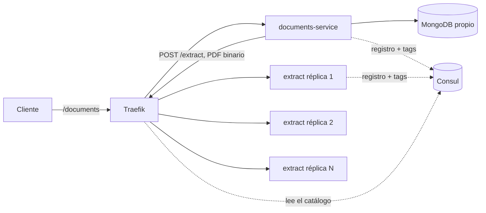

# documents-service

Microservicio de **persistencia de documentos PDF ya procesados**. Guarda, consulta y borra documentos, evita duplicados por checksum SHA-256 y orquesta la extracción de texto delegándola en `extract-service`.

Es el segundo microservicio del TP de *Test de Carga, Estrés y Optimización de Microservicio* (UTN FRSR). El primero — `extract-service`, el que se mide con k6 y Vegeta — vive en [`extract-service`](https://github.com/juandelosrios124/extract-service).

## Qué hace y qué no

**Hace:** guardar, consultar y borrar documentos; deduplicar por checksum; orquestar la extracción con un timeout y traducir cada falla de extract a un código HTTP claro. El circuit breaker, el retry y el límite de concurrencia hacia extract los aplica Traefik (ver [Resiliencia](#resiliencia)).

**No hace:** extraer texto (eso es de `extract-service`), autenticar usuarios, resumir ni traducir. Tampoco agrega endpoints ni dependencias a `extract-service`: la ruta que se mide en el TP queda intacta.

## Por qué existe

`extract-service` se satura bajo carga — en las mediciones del repo hermano, 40,8 % de éxito y P95 de 30 s con Vegeta a 50 req/s. Alguien tiene que reaccionar bien a eso: fallar rápido, no reintentar a ciegas y seguir sirviendo lecturas mientras el extractor está caído. Ese trabajo se reparte entre Traefik, que protege el tráfico hacia extract, y este servicio, que no reintenta, deduplica y le dice al cliente cuándo volver.

## Arquitectura



Traefik ([`pdf_extractext-infra`](https://github.com/juandelosrios124/pdf_extractext-infra)) es el gateway del sistema: arma sus rutas leyendo los **tags** que cada servicio declara al registrarse en Consul. `documents` se publica en `/documents` y llama a extract **a través de Traefik** (`EXTRACT_URL=http://traefik`): ya no elige réplicas por su cuenta. Ver [Llamar a extract a través de Traefik](#llamar-a-extract-a-través-de-traefik).

Capas, de afuera hacia adentro:

```
app/api/            HTTP: routers, DTOs y providers de dependencias
app/services/       casos de uso, cliente de extract y registro en Consul
app/repositories/   adaptador de MongoDB
app/ports.py        Protocol: lo único que la capa de servicios conoce
```

La capa de servicios depende de `Protocol`, nunca de Motor ni de httpx. Eso es lo que permite que toda la suite —incluidos los tests de resiliencia— corra sin MongoDB, sin `extract-service` y sin red externa.

## Contrato

| Método | Ruta | Descripción | Respuestas |
|---|---|---|---|
| `POST` | `/documents` | Recibe un PDF (`multipart/form-data`, campo `file`), calcula el SHA-256 y, si no existe, llama a `extract-service` y guarda el resultado | `201` nuevo · `200` duplicado (`"duplicate": true`) · `400` pedido mal formado: vacío, sin `%PDF`, sin `.pdf`, sin campo `file` o sin `multipart/form-data` · `413` demasiado grande · `422` extract no pudo procesar el PDF (dañado, cifrado o no válido), o el texto extraído supera `MAX_CONTENT_BYTES` · `502` **solo** respuesta inválida de extract · `503` + `Retry-After` si extract no está disponible o está saturado (incluye el `502`, `503`, `404` y `429` del gateway), si no hay cupo para recibir el upload o si Mongo no está disponible · `504` timeout, propio o del gateway |
| `GET` | `/documents/{id}` | Documento completo, con `content` | `200` · `404` · `503` + `Retry-After` si Mongo no está disponible |
| `GET` | `/documents?limit=&offset=` | Listado **sin** `content` | `200` · `503` + `Retry-After` si Mongo no está disponible |
| `DELETE` | `/documents/{id}` | Borra | `204` · `404` · `503` + `Retry-After` si Mongo no está disponible |
| `GET` | `/health` | Liveness, no toca nada | `200 {"status":"ok"}` |
| `GET` | `/health/ready` | Readiness: depende **solo** de su propia base | `200 {"status":"ready","database":"up"}` · `503` |

Documentación interactiva en `/docs`.

**Cambio de contrato de readiness (issue #28):** `/health/ready` ya no devuelve el campo `extract_circuit`. El circuit breaker no vive más en este servicio, así que no hay un estado que informar. Los códigos de `/documents` no cambiaron.

**Cambio de contrato de `/documents` (issue #29):**

| Situación | Antes | Ahora |
|---|---|---|
| extract responde `400` (PDF corrupto o cifrado) | `502` | `422` |
| Traefik responde `429` (`inFlightReq`) | `502` | `503` + `Retry-After` si lo trae |
| Mongo no disponible, en cualquier endpoint de `/documents` | `500` genérico | `503` + `Retry-After: MONGO_RETRY_AFTER` |
| Mensaje del `503` por error de conexión a extract | incluía el texto de httpx (host, IP) | mensaje fijo |
| `X-Request-ID` entrante fuera de `[A-Za-z0-9-]{1,64}` | se usaba tal cual | se reemplaza por un `uuid4().hex` nuevo |

Todos los errores mantienen el formato `{"detail": "..."}`. Ver [Mapeo de errores](#mapeo-de-errores).

Hacia `extract-service` el PDF viaja como **cuerpo binario** (`Content-Type: application/pdf`), que es el camino que usa la cátedra, con el `X-Request-ID` propagado.

### Ejemplo

```bash
# Siempre por Traefik (puerto 8080 de infra): documents no publica puerto en el host
curl -F "file=@informe.pdf" http://127.0.0.1:8080/documents
# 201 {"id":"...","filename":"informe.pdf","checksum":"...","content":"...","page_count":12,"duplicate":false,...}

curl -F "file=@informe.pdf" http://127.0.0.1:8080/documents
# 200 {... "duplicate":true}   <- sin volver a llamar a extract-service
```

Traefik solo rutea `/documents`. `/health`, `/health/ready` y `/docs` no pasan por el gateway: ver [Consultar una réplica](#consultar-una-réplica).

## Mapeo de errores

documents llama **una sola vez** a extract (a través de Traefik) y traduce cada respuesta a un error de dominio (`app/exceptions.py`). `ExtractorClient._parse` hace la traducción y el handler único de `create_app` (`app/main.py`) la convierte en HTTP, con `Retry-After` para los `RetryableError`.

| Respuesta de extract o del gateway | Error de dominio | HTTP al cliente |
|---|---|---|
| `200` | — | `201` / `200` (duplicado) |
| `400` o `422` de extract | `UnprocessablePdfError` | `422` |
| `413` de extract | `PayloadTooLargeError` | `413` |
| `429` (`inFlightReq` de Traefik) | `ExtractUnavailableError`, con `Retry-After` si viene | `503` |
| `503` (backpressure de extract o breaker de Traefik) | `ExtractUnavailableError`, con `Retry-After` si viene | `503` |
| `502` y `404` del gateway | `ExtractUnavailableError` | `503` |
| `504` y timeout de httpx | `ExtractTimeoutError` | `504` |
| Error de conexión de httpx | `ExtractUnavailableError` | `503` |
| Cualquier otro código, JSON inválido o campos faltantes | `ExtractProtocolError` | `502` |
| **MongoDB**: cualquier `PyMongoError` sin manejar (p. ej. `ServerSelectionTimeoutError`, `AutoReconnect`) | `DatabaseUnavailableError` | `503` + `Retry-After: MONGO_RETRY_AFTER` |

**`400` no es lo mismo que `422`.** El `400` (`InvalidPdfError`) es un pedido mal formado que documents detecta **antes** de llamar a extract: vacío, sin magic `%PDF`, sin extensión `.pdf` o sin `multipart/form-data`. El `422` (`UnprocessablePdfError`) es un archivo que **parece** un PDF pero que extract no pudo procesar: dañado, cifrado o no válido. Es culpa del archivo del cliente, no de extract, por eso ya no es un `502`. Tampoco abre el circuit breaker de Traefik, que solo cuenta errores de red y `500`–`502`. El otro `422`, `ContentTooLargeError`, es el texto extraído que no entra en Mongo.

**Mongo no disponible.** Motor falla a los `MONGO_TIMEOUT_MS` (3 s), no a los 30 s de su default. El handler de `PyMongoError` responde `503` con `Retry-After` y loguea el error con su tipo a nivel `error`. No cambia lo que ya existía: el repositorio sigue traduciendo `DuplicateKeyError` (dedupe) y `DocumentTooLarge` (`422`), y `/health/ready` sigue atrapando el fallo de su `ping` (`503` con `database: down`). `/health` no toca Mongo y sigue en `200`. Cuando Mongo vuelve, el driver reconecta solo, sin reiniciar documents.

**Mensajes fijos; el detalle, solo en el log.** Ningún mensaje que llega al cliente incluye texto de excepciones de httpx o pymongo, hosts, IPs ni URLs internas: cada error usa el `message` fijo de su clase. El detalle va a una línea `warning` del log con `extra`: el tipo de excepción y su texto (`error_type`, `error`), el código de origen (`extract_status`), el `detail` de extract (`extract_detail`, hasta 200 caracteres) o el motivo de un `200` inutilizable (`reason`). Esa línea lleva además el request id. Quedan mensajes específicos solo donde ayudan al cliente y no exponen nada interno, como los distintos `400` o el tamaño máximo en el `413`.

**`X-Request-ID`.** Se acepta solo si cumple `[A-Za-z0-9-]{1,64}`. Si no cumple (vacío, largo, con espacios, saltos de línea, acentos o caracteres de control), se genera uno nuevo con `uuid4().hex` y se loguea a nivel `info` que se reemplazó, con a lo sumo los primeros 64 caracteres del valor recibido, escapados. El id que queda es el mismo en los logs, en la respuesta y en el header que se manda a extract.

## Configuración

Todo por variables de entorno, sin valores en el código y sin secretos en el repo (12-Factor III). Ver `.env.example`.

| Variable | Default | Para qué |
|---|---|---|
| `HOST` / `PORT` | `0.0.0.0` / `8002` | Port binding (12-Factor VII). Es el puerto **del proceso**: en el host solo se usa al correr con `uv run`. En Docker el contenedor escucha en `8002` y **no se publica**: se entra por Traefik (`http://127.0.0.1:8080/documents`) |
| `DOCUMENTS_REPLICAS` | `1` | Solo para `docker compose`: cantidad de contenedores de documents (12-Factor VIII). Ver [Escalado horizontal](#escalado-horizontal) |
| `LOG_LEVEL` / `LOG_FORMAT` | `INFO` / `text` | Logs a stdout; `json` para agregadores |
| `MONGO_URI` | `mongodb://localhost:27017` | Base propia |
| `MONGO_DB_NAME` | `documents_db` | **Rechaza `pdf_extract_db`**: es del monolito |
| `MONGO_TIMEOUT_MS` | `3000` | Para que `/health/ready` y los `503` por Mongo caído lleguen en ~3 s, no en 30 |
| `MONGO_RETRY_AFTER` | `5` | Segundos del `Retry-After` del `503` cuando Mongo no está disponible |
| `SHARED_NETWORK` | `mired` | Red Docker externa compartida con Consul y `extract-service`. Misma variable en los tres repos |
| `EXTRACT_URL` | `http://localhost:8001` | Base de `extract-service`, **sin `/extract`** (el cliente lo agrega). El compose usa el gateway, `http://traefik`; rollback: `http://extract:8001` |
| `EXTRACT_TIMEOUT` | `27.0` | Presupuesto de timeouts: cliente 30 s > documents 27 s > Traefik 25 s. Corta después que Traefik, así el `504` lo da el gateway |
| `EXTRACT_CONNECT_TIMEOUT` | `2.0` | Con extract caído se falla en 2 s, no en 25 |
| `MAX_UPLOAD_SIZE` | `52428800` | No debe superar el de `extract-service` |
| `MAX_CONTENT_BYTES` | `15728640` | Tope del texto extraído, en bytes UTF-8. Se guarda inline y un documento BSON no pasa de 16 MiB: 15 MiB deja 1 MiB de margen. Debe ser > 0 y < 16 MiB o el servicio no arranca. Si se supera → `422` sin tocar Mongo |
| `MAX_CONCURRENT_UPLOADS` | `4` | Uploads retenidos en memoria a la vez, **por réplica**. Cada uno puede ocupar hasta dos copias del PDF: con 512 MB y 50 MB por archivo, 4 deja margen. Como cada upload hace a lo sumo una llamada a extract, también acota las extracciones simultáneas |
| `UPLOAD_SLOT_TIMEOUT` | `2.0` | Sin cupo de upload en ese tiempo → `503`, sin haber leído el body |
| `CONSUL_ENABLED` | `false` (compose: `true`) | **Solo** el registro en Consul, con los tags que publican a documents en Traefik. No cambia a dónde se llama a extract. Apagado: el servicio funciona igual sin Consul |
| `CONSUL_HTTP_ADDR` | `http://consul:8500` | Agente de Consul, visto desde `mired` |
| `CONSUL_HTTP_TOKEN` | *(vacío)* | Token de ACL. Va en el `.env` (no versionado), con el valor de `CONSUL_DOCUMENTS_TOKEN` del `.env` de infra. Ver [Qué va en el `.env` de cada repo](https://github.com/juandelosrios124/pdf_extractext-infra#qué-va-en-el-env-de-cada-repo) |
| `CONSUL_TIMEOUT` | `2.0` | Tope para hablarle al agente: el arranque no espera a un Consul que no responde |

Las variables del circuit breaker, el bulkhead y la caché de Consul (`BREAKER_*`, `MAX_CONCURRENT_EXTRACTIONS`, `BULKHEAD_ACQUIRE_TIMEOUT`, `CONSUL_CACHE_TTL`) se eliminaron en la issue #28. Un `.env` viejo que todavía las tenga arranca igual: `Settings` ignora las variables que no conoce.

## Cómo levantarlo

### Con Docker

Para levantar el sistema completo en orden (infra, extract y documents), lo recomendado es `make up` en `pdf_extractext-infra`: ver [Levantar el sistema completo](https://github.com/juandelosrios124/pdf_extractext-infra#levantar-el-sistema-completo). Lo que sigue levanta solo este stack. En los dos casos, el `.env` de este repo tiene que tener el token de Consul (ver [Service discovery con Consul](#service-discovery-con-consul)).

```bash
cp .env.example .env          # y completar CONSUL_HTTP_TOKEN
docker network create mired   # una sola vez por maquina; si ya existe, ignorar el error
docker compose up -d --build --wait
docker compose ps             # STATUS "healthy" = el /health del HEALTHCHECK responde
curl http://127.0.0.1:8080/documents   # por Traefik: necesita infra levantada y Consul
```

documents **no publica puerto en el host**: con varias réplicas, dos contenedores no pueden publicar el mismo. Desde afuera se entra solo por Traefik.

`mired` es la red externa que comparten los tres repos del proyecto: ahí viven Consul y las réplicas de `extract-service`. Al ser externa, `docker compose up` falla si no se creó antes, y `docker compose down` no la borra. Mongo queda **solo** en la red privada de este stack: es la base de este servicio y nadie de `mired` tiene por qué alcanzarla.

Levanta `documents` y su MongoDB, ambos con límites explícitos de CPU y RAM. Ajustables por entorno: `DOCUMENTS_CPUS`, `DOCUMENTS_MEMORY`, `MONGO_CPUS`, `MONGO_MEMORY`. Los de documents son **por réplica**.

#### Consultar una réplica

`/health`, `/health/ready` y `/docs` no están ruteados por Traefik, y no conviene que lo estén: con N réplicas, un health a través del balanceador contesta una cualquiera y no dice nada de una instancia en particular. Para mirar una réplica concreta:

```bash
# Estado de cada contenedor (el HEALTHCHECK de la imagen pega a /health)
docker compose ps documents

# Lo que ve Consul: un check por réplica, con su ID (hostname) e IP.
# Token de Traefik (solo lectura), leído del .env de infra sin imprimirlo ni
# exportarlo (ver "Service discovery con Consul" más abajo)
token=$(sed -n 's/^CONSUL_TRAEFIK_TOKEN=//p' ../pdf_extractext-infra/.env)
curl -s -H "X-Consul-Token: $token" http://127.0.0.1:8500/v1/health/service/documents | python -m json.tool

# Pegarle a una réplica desde adentro (la imagen no trae curl; --index es 1..N)
docker compose exec --index 2 documents python -c \
  "import urllib.request; print(urllib.request.urlopen('http://localhost:8002/health/ready').read().decode())"

# El esquema OpenAPI de /docs, sacado de una réplica
docker compose exec documents python -c \
  "import urllib.request; print(urllib.request.urlopen('http://localhost:8002/openapi.json').read().decode())" > openapi.json
```

El `curl` a Consul, en fish:

```fish
set -l token (string match -rg '^CONSUL_TRAEFIK_TOKEN=(.*)' < ../pdf_extractext-infra/.env)
curl -s -H "X-Consul-Token: $token" http://127.0.0.1:8500/v1/health/service/documents | python -m json.tool
```

Para usar la UI interactiva de `/docs`, correr el servicio en el host (ver [Local](#local)): ahí `PORT` sí se escucha en `http://localhost:8002/docs`.

### Local

El proceso en el host, con `uv run`: para la UI de `/docs` o para desarrollar. El sistema completo se levanta con Docker (ver [Con Docker](#con-docker)).

```bash
uv sync
cp .env.example .env                # el mismo .env sirve para Docker
# Un Mongo aparte, publicado solo en 127.0.0.1: el del compose no publica puerto
docker run -d --name documents-mongo -p 127.0.0.1:27017:27017 mongo:7.0
uv run --env-file .env python -m app
```

**Mongo.** El `mongo` del compose no publica su puerto: es la base privada del stack y solo se alcanza desde su red. Por eso `docker compose up -d mongo` no sirve para `uv run`: desde el host no hay nada escuchando en `localhost:27017`. Hace falta un Mongo que escuche en el host, como el contenedor de arriba o uno propio. Si el `27017` ya está ocupado, publicarlo en otro puerto y ajustar `MONGO_URI` en el `.env`. Es una base distinta de la del compose, porque no comparte el volumen `documents_data`: lo que se guarde corriendo local no aparece en Docker, y al revés. Para pararlo: `docker stop documents-mongo`.

**Variables comentadas.** En el `.env.example`, `LOG_FORMAT`, `CONSUL_ENABLED` y `EXTRACT_URL` vienen comentadas porque ya son los defaults de `Settings` (`text`, `false` y `http://localhost:8001`): con `uv run` no hace falta descomentarlas. Solo hay que descomentarlas para cambiar el valor, por ejemplo `EXTRACT_URL=http://localhost:8080` para llamar a extract a través de Traefik. Pero entonces ese `.env` deja de servir para Docker: el compose interpola esas variables desde el `.env`, así que un `EXTRACT_URL` con `localhost` apunta al propio contenedor de documents (`503`) y un `CONSUL_ENABLED=false` lo deja sin registrarse en Consul. `make check` de infra detecta los dos casos.

### Cómo apuntar a `extract-service`

Este compose **no** levanta `extract-service`: es un repositorio aparte y acoplarlos rompería la autonomía del servicio. Hay cuatro formas de conectarlos:

1. **Por Traefik** (default). `EXTRACT_URL=http://traefik`, que es lo que trae el compose: Traefik escucha en el puerto 80 de `mired` y rutea `/extract` a las réplicas que extract publicó en Consul. Lo más simple es `make up` en infra, que levanta los tres stacks en orden y espera a que Traefik rutee a extract y a documents (ver [Levantar el sistema completo](https://github.com/juandelosrios124/pdf_extractext-infra#levantar-el-sistema-completo)):
   ```bash
   cd ../pdf_extractext-infra && make up
   ```
   La alternativa es hacerlo a mano, en el mismo orden. El token no se antepone al comando: ya está en el `.env` de cada repo. A diferencia de `make up`, `--wait` no espera a que Traefik rutee: cada servicio entra en la rotación unos segundos después, cuando su check de Consul pasa a `passing`.
   ```bash
   docker network create mired                      # una sola vez
   cd ../pdf_extractext-infra && docker compose up -d --wait
   cd ../extract-service && docker compose up -d --build --wait
   cd ../documents-service && docker compose up -d --build --wait
   ```
2. **Directo a extract en `mired`, sin Traefik** (rollback). `EXTRACT_URL=http://extract:8001`: el DNS de Docker devuelve una IP por réplica.
   ```bash
   EXTRACT_URL=http://extract:8001 docker compose up -d
   ```
3. **extract corriendo en el host.** `EXTRACT_URL=http://host.docker.internal:8001`. El `extra_hosts: host-gateway` hace que ese nombre resuelva también en Linux.
   ```bash
   cd ../extract-service && uv run --env-file .env python -m extractor
   ```
4. **extract en otra máquina.** `EXTRACT_URL=http://host-remoto:8001`.

### Service discovery con Consul

Con `CONSUL_ENABLED=true`, el servicio se registra en [Consul](https://github.com/juandelosrios124/pdf_extractext-infra) al arrancar y se desregistra al apagarse. En `Settings` viene **apagado** y el compose lo **enciende** (como extract), porque registrarse es lo que lo publica en Traefik. Sin Consul funciona igual, y si el registro falla arranca de todas formas y solo queda un `WARNING` en el log. `CONSUL_ENABLED` controla **solo** el registro: a extract se llama siempre por `EXTRACT_URL`.

El Consul de infra corre con ACLs en `default_policy = "deny"`: sin un token válido, Consul rechaza el registro (`403`) y Traefik nunca rutea a documents, aunque Docker lo muestre `healthy`. El token va en el `.env` de este repo, con el valor de `CONSUL_DOCUMENTS_TOKEN` del `.env` de infra (no el de management):

```dotenv
# .env de documents-service
CONSUL_HTTP_TOKEN=<valor de CONSUL_DOCUMENTS_TOKEN del .env de infra>
```

Después:

```bash
docker compose up -d --build --wait   # Compose recrea los contenedores si cambió el token
```

No hay que exportarlo en el shell ni anteponerlo al comando: Compose les da prioridad a las variables del shell sobre el `.env`, así que un valor exportado (por ejemplo, el de management) pisaría el correcto. Si documents no se registra, el log lo dice:

```bash
docker compose logs documents | grep "No se pudo registrar"
```

Qué token va en cada repo: [Qué va en el `.env` de cada repo](https://github.com/juandelosrios124/pdf_extractext-infra#qué-va-en-el-env-de-cada-repo).

Lo que registra:

| Campo | Valor | Por qué |
|---|---|---|
| `ID` | hostname del contenedor | Uno por instancia |
| `Name` | `documents` | |
| `Address` | su IP en `mired` | Está en dos redes; se publica la de la red compartida, que es la que ve Consul |
| `Port` | `8002` | |
| `Check` | `HTTP` a `http://<IP>:8002/health`, `Interval 10s`, `Timeout 2s` | **Liveness, no readiness.** `/health/ready` depende de Mongo: un blip de la base nos sacaría del catálogo cuando todavía servimos lecturas y rechazamos escrituras correctamente |
| `DeregisterCriticalServiceAfter` | `1m` | Un `docker kill` no da tiempo a desregistrarse |
| `Tags` | ver abajo | Lo que lee Traefik para publicar el servicio |

Los tags salen de `traefik_tags()` (`app/services/consul.py`), igual que en extract:

| Tag | Para qué |
|---|---|
| `traefik.enable=true` | Traefik corre con `exposedByDefault=false`: sin este tag no publica nada |
| ``traefik.http.routers.documents.rule=PathPrefix(`/documents`)`` | La ruta pública del servicio |
| `traefik.http.routers.documents.entrypoints=web` | Solo el entrypoint de tráfico; el otro es el del dashboard |

A diferencia de extract, documents **no** declara middlewares (circuit breaker, retry, inFlightReq) en Traefik.

Comprobar, con Consul levantado:

```bash
docker exec pdf_extractext-infra-consul-1 consul catalog services     # debe listar "documents"
curl -s http://127.0.0.1:8081/api/http/routers   # debe listar documents@consulcatalog y extract@consulcatalog
```

La API de Consul necesita token: sin él, las lecturas devuelven `200` con `[]`, no `403`. Alcanza el de Traefik, que es de solo lectura, tomado del `.env` de infra sin imprimirlo (ver [UI y API con token](https://github.com/juandelosrios124/pdf_extractext-infra#ui-y-api-con-token)). Desde este repo, en bash:

```bash
# Leer solo esa variable, sin exportarla: un "set -a; . .env" de infra
# exportaría también el CONSUL_HTTP_TOKEN de management y pisaría este .env
token=$(sed -n 's/^CONSUL_TRAEFIK_TOKEN=//p' ../pdf_extractext-infra/.env)
curl -s -H "X-Consul-Token: $token" "http://127.0.0.1:8500/v1/health/service/documents?passing"
```

En fish:

```fish
set -l token (string match -rg '^CONSUL_TRAEFIK_TOKEN=(.*)' < ../pdf_extractext-infra/.env)
curl -s -H "X-Consul-Token: $token" "http://127.0.0.1:8500/v1/health/service/documents?passing"
```

El token viaja en el header `X-Consul-Token`, sale del `.env` y no se escribe en los logs.

### Llamar a extract a través de Traefik

Hasta la issue #27, con `CONSUL_ENABLED=true` documents le preguntaba a Consul por las réplicas `passing` de extract y elegía una por pedido. Ahora **eso lo hace Traefik**: descubre las réplicas en el catálogo de Consul, balancea entre ellas y las saca de la rotación cuando su check deja de estar `passing`. documents siempre llama a una URL fija, `EXTRACT_URL`, con o sin Consul.

| | Antes (#24) | Ahora (#27) |
|---|---|---|
| Destino | una réplica `passing`, elegida por documents | `EXTRACT_URL` = `http://traefik` |
| Quién descubre réplicas | documents (`GET /v1/health/service/extract`) | Traefik (provider Consul Catalog) |
| `CONSUL_ENABLED` | registro + discovery | **solo** el registro |

**Ojo con la URL:** el cliente agrega `/extract` a la base, así que es `EXTRACT_URL=http://traefik`, **no** `http://traefik/extract`.

**Respuestas propias del gateway.** Llamando a extract directo no podían ocurrir; a través de Traefik son la forma en que avisa que no llegó a una réplica. `ExtractorClient._parse` las traduce:

| Traefik responde | Por qué | documents lo trata como | Al cliente |
|---|---|---|---|
| `504` | cortó por `responseHeaderTimeout` (25 s) | `ExtractTimeoutError` (no se reintenta) | `504` |
| `502` | no pudo hablar con la réplica | `ExtractUnavailableError` | `503` |
| `404` | no tiene ruta: extract no está registrado en Consul (se loguea un `WARNING`) | `ExtractUnavailableError` | `503` |
| `503` | su circuit breaker está abierto, o "no available server" | `ExtractUnavailableError`, como el `503` de extract | `503` |
| `429` | el `inFlightReq` (`extract-inflight`) superó su tope | `ExtractUnavailableError`, con `Retry-After` si lo trae | `503` |

**Un solo circuit breaker: el de Traefik.** Desde la issue #28 el único es el middleware `extract-cb`, declarado por extract en sus tags. documents no lleva la cuenta de estas respuestas: solo las traduce. El discovery propio (elegir réplicas en Consul) también se borró en esa issue.

**Rollback.** Si Traefik da problemas, se vuelve a llamar a extract directo, sin tocar código:

```bash
EXTRACT_URL=http://extract:8001 docker compose up -d
```

El log de arranque (`Servicio iniciado`) dice a dónde se llama (`extract_destino`) y si el registro en Consul está activo (`consul_registro`) y salió bien (`consul_registrado`).

Comprobar, con todo levantado:

```bash
# Routers que armó Traefik: documents y extract
curl -s http://127.0.0.1:8081/api/http/routers | python -m json.tool | grep '"name"'

# Un upload que entra por Traefik, pasa por documents y vuelve a entrar por Traefik hacia extract.
# El mismo X-Request-ID aparece en el access log de Traefik (los dos pedidos) y en los logs de ambos servicios.
curl -H "X-Request-ID: prueba-traefik-1" -F "file=@informe.pdf" http://127.0.0.1:8080/documents
docker logs pdf_extractext-infra-traefik-1 2>&1 | grep prueba-traefik-1
```

## Escalado horizontal

documents escala agregando contenedores (12-Factor VIII), no workers dentro de uno:

```bash
DOCUMENTS_REPLICAS=3 docker compose up -d --wait   # sube a 3
DOCUMENTS_REPLICAS=1 docker compose up -d --wait   # vuelve a 1
```

`DOCUMENTS_REPLICAS` va a `deploy.replicas` del compose (default `1`). `--wait` espera el healthcheck de Docker, no el de Consul: una réplica nueva o reiniciada entra a la rotación de Traefik recién cuando su check pasa a `passing`, unos segundos después (a lo sumo un intervalo, 10 s). Ninguna réplica guarda estado que otra necesite: desde la issue #28 no hay circuit breaker, bulkhead ni discovery en memoria. Lo que hace que N réplicas funcionen como una:

| Pieza | Qué garantiza | Dónde |
|---|---|---|
| Sin puerto publicado | Que N contenedores puedan arrancar a la vez: el compose usa `expose`, no `ports`. Se entra solo por Traefik | `docker-compose.yml` |
| Consul | Cada réplica se registra con su **hostname** como `ID` (único por contenedor) y su IP en `mired`, con su propio check de `/health`. Se desregistra en el shutdown del lifespan; si muere sin apagarse (`docker kill`), su check pasa a `critical` y sale de la rotación | `build_registrar` en `app/services/consul.py` |
| Traefik | Publica `/documents` con los tags de Consul y balancea (round robin) entre las instancias `passing`. No hay middlewares para documents: ni retry ni circuit breaker | `traefik_tags()` en `app/services/consul.py` |
| Índice único `ux_documents_checksum` | El dedupe entre réplicas. El chequeo previo (`find_by_checksum`) es por proceso y puede perder la carrera; el índice no. Si dos subidas iguales llegan juntas a réplicas distintas, una inserta (`201`) y la otra recibe `DuplicateChecksumError` y responde `200` con `duplicate: true` y el mismo `id` | `app/db/mongo.py`, `app/services/document_service.py` |

**Capacidad.** El cupo de admisión es por proceso, así que con N réplicas el sistema admite **N × `MAX_CONCURRENT_UPLOADS`** uploads a la vez (3 × 4 = 12 con los defaults) y, como cada upload hace a lo sumo una llamada a extract, también hasta ese número de extracciones en vuelo hacia Traefik. La memoria reservada crece igual: **N × `DOCUMENTS_MEMORY`** (3 × 512 MB = 1,5 GB) y N × `DOCUMENTS_CPUS`. El cupo de cada réplica no se reparte con las demás: Traefik balancea por pedido, no por carga, así que una réplica puede responder `503` por falta de cupo mientras otra tiene lugar.

**Mongo es uno solo.** Todas las réplicas comparten el mismo MongoDB (database per service: la base es del servicio, no de la réplica). Escalar documents no escala la base.

## Resiliencia

**documents-service no implementa el circuit breaker: lo aplica Traefik sobre el tráfico hacia extract-service.** Lo mismo pasa con el retry y el límite de concurrencia. Hasta la issue #28 estaban escritos a mano acá, junto con un bulkhead y un discovery propio. Se borraron porque duplicaban al gateway y porque el breaker propio tenía bugs verificados:

- contaba como fallas los rechazos de su propio bulkhead;
- contaba los `400` de PDFs corruptos, así que 5 PDFs rotos abrían el circuito para todos;
- un éxito de una llamada vieja cerraba un circuito abierto.

| Patrón | Dónde vive ahora | Cómo se configura |
|---|---|---|
| Circuit breaker | Traefik: middleware `extract-cb` | Tags de Consul de extract-service: `TRAEFIK_CB_EXPRESSION`, `TRAEFIK_CB_FALLBACK`, `TRAEFIK_CB_RECOVERY` (ver [Publicación en Traefik](https://github.com/juandelosrios124/extract-service#publicación-en-traefik)) |
| Retry | Traefik: middleware `extract-retry`, solo ante error de red y no ante un `503` | Tags de extract-service: `TRAEFIK_RETRY_ATTEMPTS` |
| Límite de concurrencia | Traefik: middleware `extract-inflight` (`inFlightReq`) | Tags de extract-service: `TRAEFIK_INFLIGHT` |
| Timeout | documents (cliente httpx) + Traefik (`responseHeaderTimeout`, 25 s) | `EXTRACT_TIMEOUT` (27 s) y `EXTRACT_CONNECT_TIMEOUT` (2 s) acá. El de Traefik, en infra. Ver el [presupuesto de timeouts](https://github.com/juandelosrios124/pdf_extractext-infra#presupuesto-de-timeouts) |
| Admisión de uploads | documents (`app/api/documents.py`) | `MAX_CONCURRENT_UPLOADS`, `UPLOAD_SLOT_TIMEOUT` |
| Deduplicación por checksum | documents (`app/services/document_service.py` + índice único) | — |
| Mapeo de errores a HTTP, incluido el `Retry-After` de un `503` | documents (`ExtractorClient._parse` + handler en `app/main.py`) | — |

Lo que hace documents en cada llamada:

- **Un solo intento.** `ExtractorClient` hace un `POST` con el timeout del cliente httpx y nada más. Un timeout nunca se reintenta: reenviar un PDF de varios megabytes a un servicio ya saturado duplicaría la carga sobre el cuello de botella que el TP pide no empeorar. Un `503` tampoco se reintenta. Se le pasa al cliente con el `Retry-After` del gateway, si lo trae (en sus dos formas legales: segundos y HTTP-date).
- **Con extract caído**, los primeros pedidos esperan el timeout (`504` del gateway a los 25 s) o fallan rápido si la conexión se rechaza (`503`). Después, cuando se abre el breaker de Traefik o el check de Consul saca a las réplicas de la rotación, los siguientes reciben `503` en milisegundos. Los `GET` no dependen de extract y siguen respondiendo.
- **Sin bulkhead propio.** Cada upload admitido hace a lo sumo una llamada a extract, así que `MAX_CONCURRENT_UPLOADS` acota también las extracciones simultáneas. El pool de conexiones de httpx se dimensiona con ese mismo valor.

**Límite de tamaño y control de admisión del upload.** `POST /documents` no declara un `UploadFile`: con `File(...)`, FastAPI parsea todo el multipart (y vuelca a disco lo que pase de 1 MB) *antes* de que corra el endpoint, así que ningún chequeo de tamaño llegaba a tiempo. El endpoint lee el body él mismo, en este orden:

1. `Content-Length` declarado mayor que `MAX_UPLOAD_SIZE` + 64 KiB de margen para el framing → `413`, sin leer el body y sin tomar cupo.
2. Sin `multipart/form-data` con boundary → `400`.
3. Toma un cupo de admisión (`MAX_CONCURRENT_UPLOADS`). Si no se libera en `UPLOAD_SLOT_TIMEOUT` → `503` + `Retry-After`, sin leer el body.
4. Lee `request.stream()` y corta con `413` apenas se pasa del límite + margen. El `Content-Length` puede mentir o faltar (chunked); lo que acota la memoria es el total leído.
5. Parsea el multipart en memoria (`app/api/multipart.py`, sobre el parser de bajo nivel de `python-multipart`) y exige que el archivo no supere `MAX_UPLOAD_SIZE` exacto.

El cupo cubre lectura, extracción y persistencia, porque el PDF queda en memoria hasta el final, y se libera siempre: tras un error, tras un `413` o si el cliente corta. Acota la memoria del proceso y, de paso, cuántas llamadas a `extract-service` hay en vuelo. El tamaño es un límite de transporte y vive solo en la capa HTTP; `DocumentService` valida solo reglas de dominio (vacío, extensión `.pdf`, magic `%PDF`).

**Idempotencia.** El checksum se consulta *antes* de llamar a extract, así un PDF repetido se sirve como duplicado aunque el gateway esté rechazando extracciones. La garantía real es el índice único `ux_documents_checksum`: si dos subidas idénticas corren la carrera, en la misma réplica o en réplicas distintas, el índice gana y la segunda recibe `200` con `duplicate: true`.

## Patrones del apunte y dónde están en el código

| Patrón | Dónde | Test |
|---|---|---|
| Circuit Breaker, Retry y límite de concurrencia | **Traefik**: middlewares `extract-cb`, `extract-retry` y `extract-inflight`, declarados en los tags de Consul de extract-service. documents no los implementa | `tests/test_resilience.py` (documents no reintenta y propaga el `503` con `Retry-After`) |
| Timeout | `EXTRACT_TIMEOUT` en `app/config.py`, cliente httpx armado en `app/main.py` | `tests/test_resilience.py`, `tests/test_extractor_client.py` |
| Control de admisión (*load shedding*) | `app/api/documents.py` | `tests/test_upload_limits.py` |
| Mapeo de errores, incluidas las respuestas del gateway y Mongo caído | `app/services/extractor_client.py`, `app/exceptions.py`, handlers en `app/main.py` | `tests/test_extractor_client.py`, `tests/test_api_documents.py`, `tests/test_database_unavailable.py` |
| Health Check API | `app/api/health.py` | `tests/test_api_health.py` |
| Database per service | `docker-compose.yml` (Mongo propio, sin puerto publicado) + validador en `app/config.py` | `tests/test_config.py` |
| Externalized configuration | `app/config.py` | `tests/test_config.py` |
| Idempotencia por checksum | `app/services/document_service.py` + índice único en `app/db/mongo.py` | `tests/test_document_service.py`; la carrera entre réplicas, en `tests/integration/test_mongo_repository.py` |
| Escalado horizontal (12-Factor VIII) | `docker-compose.yml` (`expose`, `replicas: ${DOCUMENTS_REPLICAS:-1}`) + registro por hostname en `app/services/consul.py` | `tests/test_compose.py`, `tests/test_consul.py` |
| Puertos y adaptadores | `app/ports.py`, `app/repositories/`, `app/services/extractor_client.py` | toda la suite corre con dobles |
| Correlación de requests, con validación del `X-Request-ID` entrante | `app/middleware.py` | `tests/test_correlation.py` |
| API Gateway + service discovery (Traefik lee los tags de Consul) | `traefik_tags()` en `app/services/consul.py`, `EXTRACT_URL` en `docker-compose.yml` | `tests/test_consul.py` |
| Logs a stdout | `app/logging_config.py` | `tests/test_logging.py` |

## Tests

```bash
uv run pytest                 # 316 tests, sin MongoDB ni extract-service, ~3 s
```

`tests/test_compose.py` lee el compose interpolado con `docker compose config` (no necesita el daemon ni la red `mired`, y usa un `--env-file` vacío para que el `.env` local no influya). Si no hay Docker en la máquina, se saltea.

Los tests de resiliencia (`tests/test_resilience.py`) arman la app con el wiring de producción: el `ExtractorClient` lo construye el lifespan desde `Settings`. Las respuestas del gateway salen de `respx`. El timeout y la conexión rechazada se prueban contra un socket local de verdad, porque `respx` no aplica los timeouts de httpx. Así entran en la corrida de siempre en vez de quedar salteados.

Los tests que necesitan un MongoDB real están aparte y excluidos por default:

```bash
docker compose up -d mongo
MONGO_URI=mongodb://localhost:27017 uv run pytest tests/integration -m integration --override-ini addopts=
```

Cubren lo que un doble no puede probar honestamente: que el índice único rechaza de verdad un checksum repetido, también con 20 inserts concurrentes desde dos clientes (dos réplicas) y con dos `DocumentService` que extraen a la vez el mismo PDF, que los timestamps vuelven con zona horaria y que un `content` de 15 MiB entra en Mongo mientras que uno de 17 MiB termina en `ContentTooLargeError` y no en un `500`.

## Decisiones de diseño

- **Estructura.** Sobre el esqueleto sugerido en la especificación se agregaron `models.py`, `ports.py`, `exceptions.py`, `clock.py` y `db/`. Cada uno es un concern separado con test propio, y espejan el layering de `extract-service`.
- **Sin motor de migraciones.** `create_index` es idempotente; una llamada en el lifespan alcanza (KISS). Copiar el motor de migraciones del repo hermano traería un lock distribuido que acá no hace falta — y dos servicios migrando la misma base competirían por él.
- **`tz_aware=True` en el cliente de Mongo.** Sin eso, un documento recién creado serializa con `+00:00` y el mismo documento releído serializa naive: el mismo recurso con dos representaciones según si el proceso se reinició.
- **El listado siempre ordena por `_id` descendente.** `find().skip().limit()` sin `sort` no tiene orden definido en MongoDB, y `offset=10` podría devolver filas ya vistas en `offset=0`.
- **El middleware de correlación es ASGI puro.** `BaseHTTPMiddleware` corre la app en otra task, así que un `ContextVar` seteado antes de `call_next` no se ve de forma confiable desde el endpoint: el request id saldría como `-` en todos los logs de la capa de servicios.
- **El `HEALTHCHECK` apunta a `/health`, no a `/health/ready`.** Atar el healthcheck del contenedor a la readiness significa que un parpadeo de Mongo reinicia un proceso que estaba sano.
- **Se guarda `page_count` y `size_bytes`** aunque el contrato mínimo no los pida: el primero viene gratis de la extracción y tirarlo después de pagarla es peor que cargarlo, y los dos son lo que hace útil al listado sin `content`.

## Límites conocidos

- **Se escala con réplicas, no con workers.** Cada contenedor corre un solo proceso de uvicorn, sin `workers`. Con workers, N procesos quedarían detrás de un solo registro en Consul y un solo check, y el cupo de uploads (que vive en memoria) se multiplicaría dentro de un límite de memoria pensado para uno. Con réplicas, cada proceso tiene su registro, su check y su límite. Ver [Escalado horizontal](#escalado-horizontal).
- **La carrera de duplicados cuesta extracciones.** Dos subidas simultáneas del mismo PDF que caen en réplicas distintas (o en la misma) pasan las dos el chequeo de checksum antes de que alguna inserte, así que **las dos llaman a extract** y recién el índice único decide. El resultado es correcto (un `201`, el resto `200 duplicate` con el mismo `id`), pero se paga una extracción de más por cada subida que entró en la carrera: en el peor caso, tantas como uploads admitidos a la vez (réplicas × `MAX_CONCURRENT_UPLOADS`). Evitarlo requeriría un lock o una reserva del checksum antes de extraer, que no se justifica para el TP.
- **El texto extraído tiene tope (`MAX_CONTENT_BYTES`).** Se guarda inline en el documento, y un PDF de 50 MB puede dar más texto del que entra en los 16 MiB de BSON. El chequeo es después de la extracción, así que un documento rechazado por tamaño ya pagó la llamada a `extract-service` y **no queda guardado**: si se vuelve a subir, se vuelve a extraer. Guardar textos más grandes requeriría GridFS, que queda fuera del alcance.
- **Un PDF rechazado con `422` no se guarda.** Si extract no pudo procesarlo, no queda nada en Mongo, así que tampoco hay checksum para deduplicar: si se vuelve a subir el mismo archivo, se vuelve a llamar a extract (y vuelve a dar `422`). Es a propósito: guardar los rechazos sería persistir algo que no es un documento.
- **La paginación con `skip` es O(offset).** Para colecciones grandes correspondería un cursor, pero el TP no lo necesita (YAGNI).
- **Este stack suma memoria.** No conviene levantarlo mientras se corren las mediciones de carga sobre `extract-service`.

## Pruebas de carga

Están en [`extract-service/tests/stress/`](https://github.com/juandelosrios124/extract-service/tree/main/tests/stress) y apuntan **solo** a `extract-service`, que es el servicio que mide la consigna. Este repositorio no agrega scripts de k6 ni de Vegeta a propósito: medir este servicio con el benchmark de la cátedra daría números no comparables.
